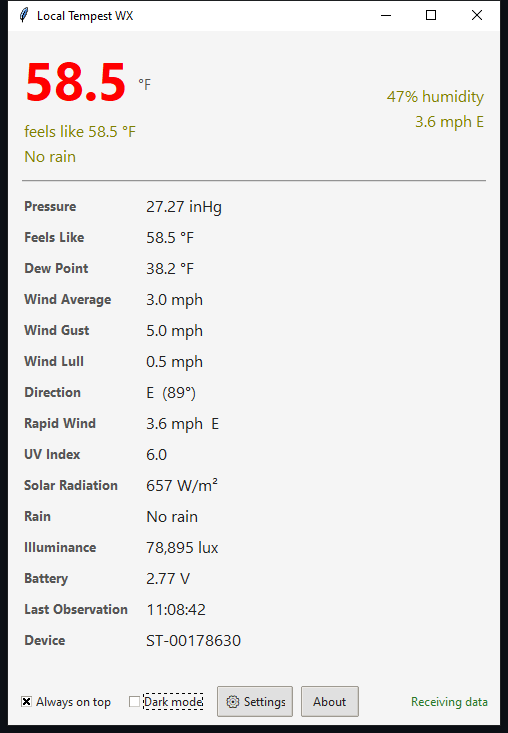
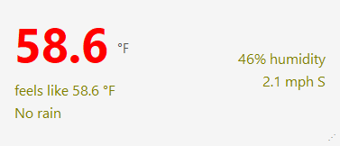
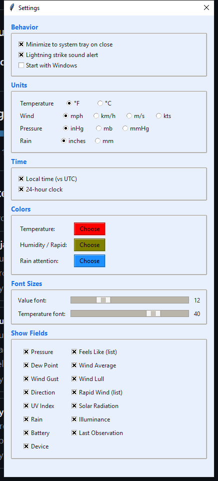
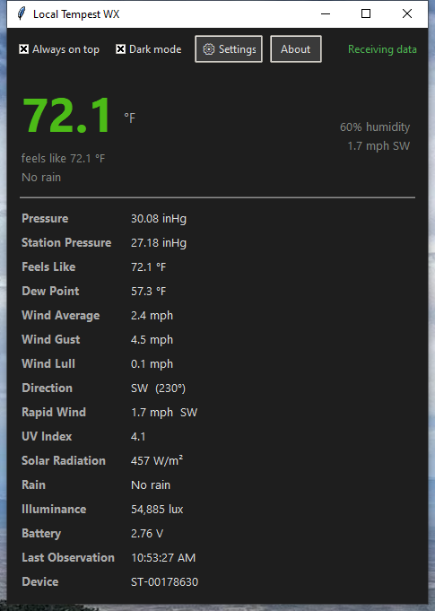
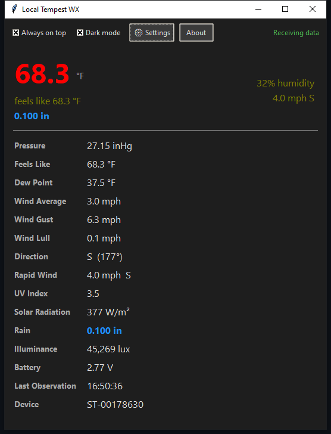

# Local Tempest WX

A lightweight, cross-platform desktop application that displays real-time weather data from a WeatherFlow Tempest station using the local UDP broadcast (port 50222). No cloud account or internet connection is required.

## Features

- Real-time display of temperature, humidity, wind, pressure, rain, UV, solar radiation, and more
- **Sea-level pressure** calculation using the official WeatherFlow/AMS formula (requires elevation)
- **Station pressure** shown separately
- **Air density** (kg/m³ or lb/ft³)
- **Rain rate** with category (None, Very Light, Light, Moderate, Heavy, etc.)
- Feels-like temperature and dew point
- Rapid wind updates
- Lightning strike alerts with optional sound and distance in km or miles
- Compact mode (borderless on Windows) with drag-to-move and resize grip
- Dark mode and always-on-top
- Customizable colors, font sizes, and visible fields
- System tray support (minimize to tray)
- Windows autostart option
- Persistent settings saved to `tempest_display_config.json`
- Testing tools for lightning and rain (useful when weather is calm)
- Rounded corners on Windows 11 / recent Ubuntu

## Requirements

- Python 3.8 or newer
- Tkinter (usually included with Python)
- Optional (for tray icon):
  ```bash
  pip install pystray Pillow
  ```

## Installation

### Run from source
```bash
python local_tempest_wx.py
```

### Windows executable (recommended)
1. Install dependencies:
   ```bash
   pip install pystray Pillow pyinstaller
   ```
2. Build a single-file executable:
   ```bash
   pyinstaller --onefile --windowed --hidden-import=pystray._win32 --hidden-import=PIL.Image --hidden-import=PIL.ImageDraw local_tempest_wx.py
   ```
3. The executable will be in the `dist` folder.

### Create an installer (optional)
Use **Inno Setup 6** with the script provided in the project notes, or create one that points to the PyInstaller output.

## Configuration

Settings are saved automatically to `tempest_display_config.json` next to the script or executable.

Key settings:
- **Elevation** (feet or meters) — required for accurate sea-level pressure
- Units for temperature, wind, pressure, rain, air density, and lightning distance
- Dark mode, always-on-top, time format (12/24 hour, local/UTC)
- Which fields to show
- Lightning alert on/off
- Minimize to tray
- Window geometry for full and compact modes

## Compact Mode

Click the temperature to enter/exit compact mode.
- Shows temperature, feels-like, rain (with rate category when raining), humidity, and rapid wind
- Drag anywhere on the compact window to move it
- Resize grip in the bottom-right corner
- On Windows the title bar is hidden; on Linux/macOS it remains for better window manager compatibility

## Sea-Level Pressure

The **Pressure** field shows sea-level pressure calculated from station pressure + your elevation using the official WeatherFlow formula.  
**Station Pressure** shows the raw value from the Tempest.

Enter your elevation in Settings → Units.

## Screenshots

### Full View


### Compact Mode


### Settings Window


### Dark Mode


### Rain Active


## Troubleshooting

| Issue | Solution |
|-------|----------|
| No data received | Ensure the Tempest hub is on the same network and UDP port 50222 is not blocked |
| Tray icon missing | Install `pystray` and `Pillow`, then rebuild the executable |
| Preferences not saving | Run the executable from a writable folder (not `Program Files`), or check that `tempest_display_config.json` is being created next to it |
| Compact mode geometry not remembered on Linux | This is a window-manager limitation; the app tries to restore size/position but some environments ignore it |
| Lightning/rain alerts hard to test | Use the **Simulate Lightning** and **Toggle Rain** buttons in Settings → Testing |

## Credits

**Local Tempest WX**  
by silicon  
https://orangedragon.co/labs/dev

Based on the WeatherFlow Tempest UDP broadcast specification:  
https://apidocs.tempestwx.com/reference/tempest-udp-broadcast

## License

Personal use / open source. Attribution appreciated if you share or modify it.

## Changelog

### 1.6
- Official WeatherFlow/AMS sea-level pressure formula
- Air density with kg/m³ or lb/ft³ preference
- Rain rate category (None, Very Light, Light, Moderate, Heavy, etc.)
- Rain rate shown next to rain amount in compact mode when raining
- Elevation unit selectable (feet or meters)
- Dark mode entry field visibility fix
- Rain Rate field positioned next to Rain in the display and Settings

### Earlier versions
- Compact mode with geometry persistence
- System tray and Windows autostart
- Lightning distance unit (km/miles) and notification toggle
- Testing tools for lightning and rain
- Cross-platform improvements and Linux compact mode fixes
- Color customization, font sizing, and field visibility options

